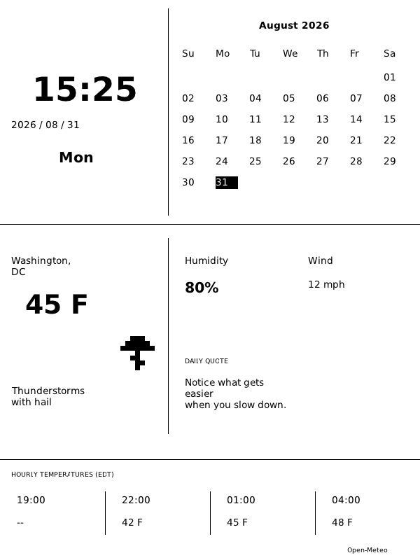
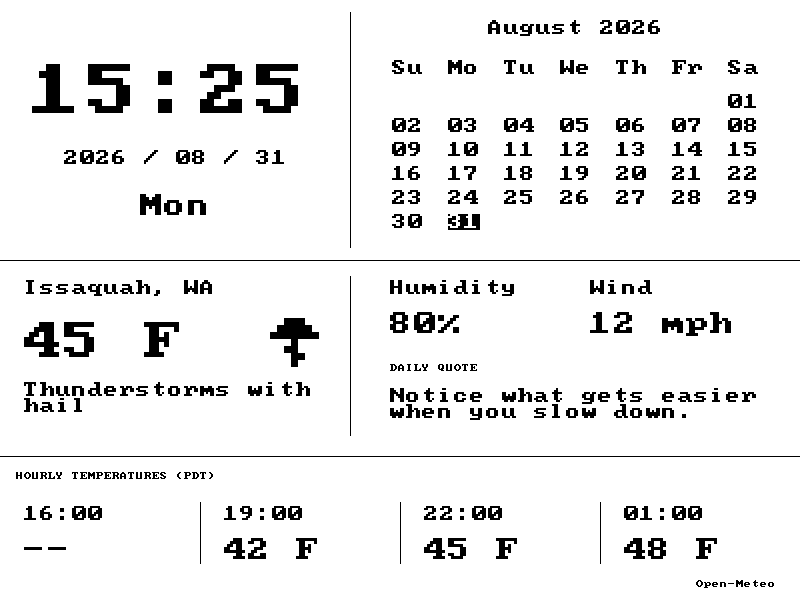

# MyDashboard for Kindle

MyDashboard replaces the stock UI with a borderless FBInk dashboard
on a jailbroken Kindle. It shows
weather from [Open-Meteo](https://open-meteo.com/), a city-local
clock and calendar, and a rotating daily quote. Washington, DC and Eastern time
are the default until you save a different city. The screen updates once per
minute, with a flashing full-screen refresh and weather fetch at startup and
every hour. If a request fails, the dashboard labels the last successful
forecast from that session as stale.

The default layout selects 800×600 landscape for the basic Kindle
(8th generation), or the original 1448×1072 landscape layout for higher-resolution
devices such as the Paperwhite 4. A 600×800 portrait layout is also available
for the basic Kindle. The compact layouts are inspired by
[KindleReborn](https://github.com/Yvetteywy/KindleReborn): divided clock/calendar
and weather panels, today's calendar date highlighted, a large temperature,
pixel-art weather icon, and four forecast samples at offsets 0, 3, 6, and 9 hours
from the fetched forecast's first entry. The larger layout retains all 12 hourly
rows. Both run locally with FBInk, without a browser, address bar, or rendering
server. Fonts are FBInk's built-in bitmap fonts, not the reference's web fonts;
the dashboard itself is display-only. City settings use a separate local browser
page opened from KUAL.

The compact weather panel shows current temperature, conditions, humidity and
wind, plus the daily quote. It does not currently fetch feels-like temperature,
daily highs/lows, UV, rain probability or AQI. Missing weather is shown as
unavailable, and failed updates label cached readings stale. The compact frame
is composed without intermediate display updates, then refreshed once per
minute; the hourly flashing refresh remains.

Startup
checks the display dimensions without changing rotation and rejects unsupported
screens before stopping the Kindle UI or changing screensaver settings.
Device rotation and UI recovery still need verification on actual hardware.

## Visual previews

These are software-rendered previews of the dashboard's drawing commands with
sample data, not screenshots captured from a Kindle. Actual device rendering
remains unverified.

### Portrait (600×800)

### Landscape (800×600)

## Install and use

1. Install KUAL and copy [MyDashboard](./MyDashboard/) to
   `/mnt/us/extensions/MyDashboard/`. Keep the scripts executable and use LF
   line endings.
2. Put compatible ARM Kindle builds of **both** `fbink` and `fbdepth` from
   [FBInk](https://github.com/NiLuJe/FBInk) in
   `/mnt/us/extensions/MyDashboard/bin/` (or on the Kindle's `PATH`). The Kindle
   also needs `curl` with working HTTPS certificate validation and the usual
   BusyBox tools. The dashboard uses `cal` if installed and draws an equivalent
   calendar itself otherwise. No separate weather server or API key is needed.
3. Connect to Wi-Fi and choose **MyDashboard → Start dashboard** in KUAL for
   landscape, or **Start portrait dashboard** for 600×800 portrait. Stop the
   running dashboard before changing orientation. From SSH, use
   `sh /mnt/us/extensions/MyDashboard/bin/start.sh portrait` for portrait;
   omitting `portrait` retains the default landscape behavior.
   The launcher keeps the current orientation if it already matches, otherwise
   it rotates only after stopping the Kindle UI, and restores rotation on exit.

## Configure a city on the Kindle

The default-city dashboard still works without Python. To enable
on-device search and saved locations, install a compatible **Python 3.9+ Kindle
runtime** with HTTPS support. Its `python3` must be on `PATH` or at
`/mnt/us/python3/bin/python3`. These are Kindle prerequisites, not packages
installed on your Mac or in a cloud workspace.

The runtime also needs IANA timezone data, either in its system zoneinfo paths or
in the Python **tzdata** package. If its package manager supports pip, install it
with that Kindle runtime's `python3 -m pip install tzdata`. Missing dependencies
are reported in `/mnt/us/mydashboard-setup.log`; they are not installed
automatically. Python is also used to validate saved settings and prepare the
timezone when starting a configured dashboard.

1. Copy the full updated `MyDashboard` folder to the Kindle, including
   `setup.html`, the Python service and both new shell launchers. Keep the shell
   launchers executable. Enable JavaScript in the Kindle browser and connect to
   Wi-Fi.
2. Select **MyDashboard → Configure city** in KUAL. It stops a running dashboard
   safely if necessary, then opens `http://127.0.0.1:8765/` in the stock browser.
   The browser bar is visible during setup only, not in the native dashboard.
   While the dashboard owns the screen, stop it over SSH or with the USB `STOP`
   file first to regain access to KUAL.
3. Enter a city or postal code. Optionally enter a two-letter country code such
   as `US`, `GB` or `JP` to narrow the results. Choose the correct city and region,
   then tap **Save selected city**. Nothing changes until a result is saved.
4. Return to KUAL and start either dashboard orientation. The weather request,
   displayed city, clock, calendar and hourly forecast now use the saved
   coordinates and timezone, including daylight-saving changes. The device's
   system timezone is not changed. Restart the dashboard after any city change.

There is **no automatic GPS or IP-based location detection**. The setup page
searches Open-Meteo's geocoding service and saves your explicit selection in
`/mnt/us/extensions/MyDashboard/location.json`. That file survives reboot and is
excluded from Git; preserve it when updating the extension. City labels are
transliterated to ASCII for the bitmap font, and long labels wrap or shorten to
fit the screen.

The local Python HTTP service is needed to let the browser save settings on the
Kindle, not to supply weather. It binds only to `127.0.0.1`, requires a session
token for API requests, and exits 15 minutes after launch. No external server or
always-on computer is required. The dashboard continues fetching Open-Meteo
directly with `curl` after setup has closed. Search errors, empty results and
save errors are shown on the page without replacing the previous saved city.
If the session expires, reopen **Configure city**. Browser launching, local
network access and the Python runtime still require testing on the actual
Kindle firmware.

Invalid saved settings or missing timezone data stop startup before the Kindle
UI is stopped; see `/mnt/us/mydashboard.log` for details. Correct the settings
through **Configure city**; the page reports malformed settings but still lets
you search and save a replacement. To reset over USB instead, back up and
rename `location.json`. Removing the active settings file restores the
Washington, DC default.

## Development checks

Run `python3 -B -m unittest discover -s tests -v` for the mocked native-renderer,
launcher and local setup HTTP tests, and `node --test tests/setup.test.cjs` for
the setup page's search/select/save flow. Check shell syntax with
`sh -n MyDashboard/bin/*.sh`. Tests use temporary settings and loopback ports;
they do not stop the workstation UI or write to a connected Kindle.

## Stop and recover

While the dashboard owns the framebuffer, the Kindle UI is stopped, so its
KUAL stop entry is not reachable on-screen. Use either of these methods:

- Over an existing SSH connection, run
  `sh /mnt/us/extensions/MyDashboard/bin/stop.sh`. The KUAL stop entry calls
  this same script.
- Over USB, create an empty file named `STOP` (no extension) in
  `/mnt/us/extensions/MyDashboard/`. Eject the drive so the Kindle can read the
  file. The dashboard consumes it on exit.

The worker exits at its next stop check, normally within five seconds when
idle, or after any current weather request or drawing finishes. The launcher
restores rotation, restarts the UI job it stopped, and re-enables the
screensaver. Keep the Kindle powered for extended use.

Startup and runtime errors are appended to `/mnt/us/mydashboard.log`, with the
last completed run's exit status in `/mnt/us/mydashboard.log.status`. These files
survive a reboot. Over USB on a Mac with the Kindle mounted as `Kindle`, read
`/Volumes/Kindle/mydashboard.log`; the Kindle's internal `/tmp` is not exposed
over USB. A forced reboot may leave no current exit status.

If the worker was
forcibly killed, the stop request times out, or the UI does not come back,
restart the Kindle with the power button. A reboot clears the transient lock
and does not auto-start the dashboard.
